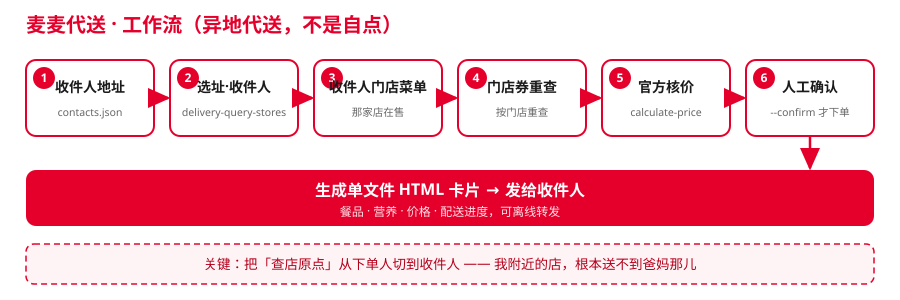

# 麦麦代送 · mcd-send-a-meal

> 用麦当劳中国 MCP，把一份麦当劳**送到别人手上**。

一句话定位：**不是「我给自己点」，而是「我给爸妈 / 恋人 / 加班的同事点一份，送到他们那儿」**。
这是 M-CODE 程序员创意开发大赛里目前**唯一一个异地代送**选题——96 个报名项目里 0 命中。

**开发方式**：全程使用腾讯 **WorkBuddy** 开发（含 Skill 形态），详见 [`workbuddy.md`](workbuddy.md)。



---

## 一句话场景

你说一句人话：

> 「给我妈点份麦当劳，她钠要少、饮料别加冰。」

麦麦代送会：**按收件人地址**找能配送的店（不是你附近）→ 拉**那家店**真实在售菜单 →
按长辈画像做控钠/忌辣/去冰求解 → 按**收件人所在门店**重查可用券 → 调官方 `calculate-price` 核价 →
把「商品价 / 券优惠 / 配送费 / 应付」**分开**报给你 → **停下来等你确认**才下单。

更多可直接复制的话术见 [`examples/demo-prompts.md`](examples/demo-prompts.md)。

---

## 为什么做这个

所有人都在做「自点」：查我附近的店、按我的口味点、送到我家。
但「**代送**」是另一件事，约束全在**收件人**身上：

| 维度 | 自点（别人都在做） | 代送（本项目） |
| --- | --- | --- |
| 查店原点 | `query-nearby-stores`（我附近） | `delivery-query-stores`（**收件人地址**） |
| 菜单 | 我看到的菜单 | **收件人门店**的在售菜单 |
| 券 | 我账户里有的券 | **按收件人所在门店重查**的券 |
| 忌口/营养 | 我的偏好 | **收件人画像**：长辈控钠、恋人控卡、同事要扛饿 |
| 出错成本 | 自己吃亏 | **替别人花钱**，地址错/忌口漏更致命 |

代送场景里最容易被忽略、但决定成败的一步是：**把「查店原点」从下单人切到收件人**。
给杭州的爸妈点餐，我附近的店根本送不到他们那儿。

---

## 实测验证（真实 MCP Token，只读）

本项目不是"看起来能跑"，而是**真连过麦当劳 MCP 并跑通只读全链路**。
完整证据见 [`docs/TEST_REPORT.md`](docs/TEST_REPORT.md)。

| 项目 | 结果 |
| --- | --- |
| ✅ 离线单测 | **59 例全绿**（`python tests/run_all.py`，无需 Token） |
| ✅ 按收件人地址找店 | 实测选中「麦当劳广州革新路餐厅 1400418」 |
| ✅ 真实菜单 | 该门店 **124 个在售餐品**，6 组进入核价 |
| ✅ 门店券重查 | 按收件人门店查到 **2 张可用券**（带 `couponCode`） |
| ✅ 官方核价 | 逐组调 `calculate-price`，应付金额以官方为准 |
| ✅ 营养约束求解 | 生效：`538kcal · 钠978mg · 蛋白28g` |

**真实 `plan` 输出摘录**（只读，未下单）：

```
  配送门店  麦当劳广州革新路餐厅（1400418）
  门店菜单  124 个在售餐品，其中 6 组进入核价
  可用券    2 张（已按收件人所在门店重查）
  收件人约束 长辈：控钠、去冰、避开难嚼和过辣的

  [3] 主餐 + 小食      麦香鱼套餐 + 麦乐鸡
      应付 ¥47.50
         538kcal · 钠978mg · 蛋白28g  ★鸡
```

### 实测发现的接口契约偏差（已对齐）

官方文档/直觉与服务端**实际行为**有多处偏差，全部由实测定位并修正——这是本项目的主要工程贡献：

- `delivery-query-stores` 外送**只接受 `beType=2`（麦乐送）**，传 5 报 `600049`
- `calculate-price` 入参要 **`productCode` + `quantity`**（非 `mealCode`/`count`），且**金额单位是「分」**
- `list-nutrition-foods` 返回的是**自定义表格字符串**（非 JSON），已写 `parse_nutrition_text()` 解析
- `query-store-coupons` 实为**结构化 JSON**（门店券带 `couponCode`），而 `query-my-coupons` 才是 markdown 文案
- 券须按 **item 级 `couponCode` 逐品注入**核价（`gmServiceCode` 是团餐专用）
- MCP 响应是**给 LLM 的 markdown**，真实数据裹在 `{success,code,data}` 信封里

完整 9 条偏差与修正见 [`docs/TEST_REPORT.md`](docs/TEST_REPORT.md) 第 3 节「实测发现的接口契约偏差」。

---

## 核心能力

- **收件人地址簿**：存「给谁、点去哪、什么忌口」，本地 JSON，不进版本库（`.gitignore` 已排除）。
- **收件人画像约束求解**：把「关系」翻译成可执行营养硬约束，本地确定性计算（热量/钠/蛋白/脂肪），**数值不进 LLM**。
- **门店智能匹配**：按收件人地址的可配送门店排序（距离 0.45 / 预计送达 0.40 / 营业 0.15），休息中的店直接淘汰。
- **真实核价 + 券逐品注入**：所有金额以官方 `calculate-price` 为准，单位「分→元」显式处理；券按目标门店重查后，
  仅对**命中券适用商品**的 item 逐品注入 `couponCode`。
- **确认门控**：任何写操作（创建订单、领券）必须显式 `--confirm`，绝不静默执行。
- **给收件人的卡片**：下单后生成一张单文件离线 HTML 卡片（含餐品、营养、价格、配送进度），顺手能转发。
- **零依赖 + 离线演示**：只用 Python 标准库；`--dry-run` 用内置样例数据，没有 Token 也能跑通完整流程。

---

## 目标用户

| 人群 | 痛点 | 麦麦代送的能力 |
| --- | --- | --- |
| 异地子女 | 想给爸妈点餐，但不知道他们那边哪家店能送、老年人该避开什么 | 按父母地址找店 + 长辈控钠/忌辣/去冰画像 |
| 异地的另一半 | 想远程请客，又怕点到对方忌口或热量超标 | 恋人控卡/控脂画像 + 方案取舍讲清楚 |
| 团队负责人 / HR | 同事加班，想点份能扛饿的 | 同事高蛋白画像 + 批量地址簿 |
| 商务 / 销售 | 给客户送餐要有分寸 | 客户偏正式画像 + 收件人卡片落款 |
| 开发者 / 评委 | 想验证「代送」到底和「自点」差在哪 | 59 例单测 + 真实只读验证报告 + 契约偏差清单 |

---

## 安装

```bash
# 需要 Python 3.10+，无任何第三方依赖
git clone https://github.com/mikelgh/mcd-send-a-meal.git
cd mcd-send-a-meal

# 看项目结构
python scripts/send_a_meal.py --help
```

> 本项目**不依赖** `requests` 等任何第三方包，标准库 `urllib` 直接打 MCP 的 Streamable HTTP。

---

## 快速开始（不需要 Token）

```bash
# 1) 用内置样例地址簿，先看「给爸妈点一份」会出什么方案（只读，不会下单）
python scripts/send_a_meal.py --dry-run --contacts examples/contacts.sample.json plan --to 爸妈

# 2) 生成一张给收件人的卡片（不下单）
python scripts/send_a_meal.py --dry-run --contacts examples/contacts.sample.json card --to 爸妈 --out out/card.html

# 3) 想验证算法正确性：59 例离线单测
python tests/run_all.py
```

`--dry-run` 走 `src/mcd_send/fixtures.py` 的离线后端，评委/同事在地铁上也能看完整流程。

---

## 真实使用（需要麦当劳 MCP Token）

1. 到 https://open.mcd.cn/mcp 登录并激活 Token。
2. 设置环境变量（**不要写进代码或配置文件**）：
   ```bash
   # Windows PowerShell
   $env:MCD_MCP_TOKEN = '你的Token'
   # Git Bash / macOS
   export MCD_MCP_TOKEN='你的Token'
   ```
   Token 也可写在项目根 `.env`（`mcp_token=...`），CLI 会自动加载；`.env` 已被 `.gitignore` 排除。
3. 准备收件人地址簿：复制 `examples/contacts.sample.json` 为 `contacts.json`，把 `address_id` 换成真实值（用 `address-new` 子命令创建）。
4. 出方案 → 确认 → 下单：
   ```bash
   python scripts/send_a_meal.py inspect                 # 先看服务端真实工具与入参名
   python scripts/send_a_meal.py plan --to 爸妈          # 只读出方案
   python scripts/send_a_meal.py send --to 爸妈 --combo 1 --confirm   # 确认后才下单
   python scripts/send_a_meal.py track --order-id <订单号>
   ```
   MCP 接入配置见 [`mcp-config.example.json`](mcp-config.example.json)。

---

## 命令速查

| 命令 | 作用 | 是否写操作 |
| --- | --- | --- |
| `inspect` | 打印 MCP Server 真实提供的 tool 与参数 | 否 |
| `contacts` | 列出地址簿与各自约束 | 否 |
| `plan --to <称呼>` | 出一份代送方案（只读） | 否 |
| `send --to <称呼> --combo N --confirm` | 按方案下单 | **是（需 --confirm）** |
| `track --order-id <ID>` | 查配送进度 | 否 |
| `cancel --order-id <ID> --confirm` | 取消订单 | **是（需 --confirm）** |
| `card --to <称呼> --out <path>` | 只生成收件人卡片 | 否 |
| `address-new --name --phone --address` | 为收件人新建配送地址 | 是（需 Token） |

---

## Skill 入口（Agent 形态）

本项目的 Skill 主体在 [`skills/mcd-send-a-meal/SKILL.md`](skills/mcd-send-a-meal/SKILL.md)——
用**官方工具名**描述代送工作流，可接入 **WorkBuddy** 及其他支持 MCP 的客户端。

装载方式（WorkBuddy）：

```
~/.workbuddy/skills/mcd-send-a-meal/SKILL.md
```

装载后在对话框里直接说「给我妈点份麦当劳，她钠要少」即可触发，
Skill 内含**红线约束**（不下单 / 不自动领券 / 不编数据 / 不猜地址 / 不静默放宽）。
演示话术见 [`examples/demo-prompts.md`](examples/demo-prompts.md#a-在-agent-里直接说skill-触发句)。

---

## 架构

```
mcd-send-a-meal/
├── src/mcd_send/
│   ├── mcp_client.py    # 零依赖 Streamable HTTP 客户端（initialize/list/call + 信封抽取）
│   ├── tools.py         # 业务工具层 + ToolSchemas（schema 驱动参数归一化）+ 营养表/券文本解析
│   ├── contacts.py      # 收件人地址簿
│   ├── profiles.py      # 收件人画像（关系→营养硬约束）
│   ├── store_match.py   # 按收件人地址排序门店（代送核心）
│   ├── menu.py          # 分类 + 营养对齐 + 约束求解
│   ├── pricing.py       # 核价拆解（分→元、净省、配送费单列）
│   ├── planner.py       # 流程编排：只读 plan_send / 写入 execute_send
│   ├── card.py          # 收件人 HTML 卡片
│   └── fixtures.py      # 离线演示后端（同接口，无需 Token）
├── scripts/send_a_meal.py   # CLI 入口
├── skills/mcd-send-a-meal/  # Skill 入口（SKILL.md）
├── tests/                   # 离线确定性单测（59 例，零依赖）
├── examples/                # contacts.sample.json + demo-prompts.md
├── docs/
│   └── TEST_REPORT.md       # 真实环境只读验证报告 + 契约偏差清单
└── mcp-config.example.json
```

**四条设计原则**

1. **数值不进 LLM**：热量、钠、蛋白的加总与阈值判定全部本地纯 Python 算，模型只讲人话。
2. **零依赖**：只标准库，任何机器可跑。
3. **Schema 驱动参数解析**：平台未公开 tool 入参 schema，故 `ToolSchemas.resolve()` 做大小写/下划线不敏感归一化，匹配不上就报错并列出合法参数名。
4. **确认门控**：替别人花钱，任何写操作必须人确认。

---

## 收件人画像（内置五类）

`parent`（控钠/去冰/忌辣）· `partner`（控卡/控脂）· `friend`（宽松）· `colleague`（高蛋白扛饿）· `client`（偏正式）。
联系人可在 `profile` 字段覆盖任意默认值。

---

## 参赛信息

- **赛事**：2026 麦当劳程序员创意开发大赛（M-CODE）
- **官方仓库**：<https://github.com/M-China/mcd-developer-innovation-challenge>
- **依赖服务**：麦当劳中国官方 MCP Server（`https://mcp.mcd.cn`，Streamable HTTP，Bearer Token）
- **开发工具**：腾讯 **WorkBuddy**（详见 [`workbuddy.md`](workbuddy.md)）
- 赛事要求文件：
  - [`README.md`](README.md)（本文件）
  - [`MCP_INTEGRATION.md`](MCP_INTEGRATION.md)（MCP Server / Tool / 调用流程 / 业务价值）
  - [`CONTEST_DECLARATION.md`](CONTEST_DECLARATION.md)（参赛声明，内容不可改）
  - [`mcp-config.example.json`](mcp-config.example.json)（脱敏配置，仅环境变量占位符）
  - [`workbuddy.md`](workbuddy.md)（WorkBuddy 专项奖励凭据）

---

## 免责声明

本作品为 M-CODE 大赛参赛作品，**非麦当劳官方产品**，与麦当劳中国无隶属或授权关系。

- 餐品、价格、优惠、门店营业状态与配送时效**一律以麦当劳官方渠道的实时结果为准**；本项目只是调用官方 MCP 接口并做确定性计算，不保证与官方 App 展示完全一致。
- 营养配餐结果**仅供生活方式参考，不构成医疗或营养学专业建议**；有特殊健康需求请遵医嘱。
- 官方营养表存在未收录的新品，本项目对该类餐品**如实标注「营养数据缺失」并跳过判定**，不按 0 计算。
- 所有下单操作均需显式确认，实际支付发生在麦当劳官方渠道，本项目不接触支付环节。
- Token 仅从环境变量读取，请勿提交到任何公开仓库。

## License

MIT · Copyright (c) 2026 Michael Li
